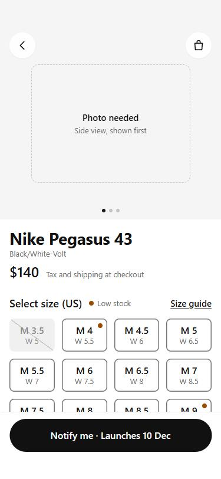
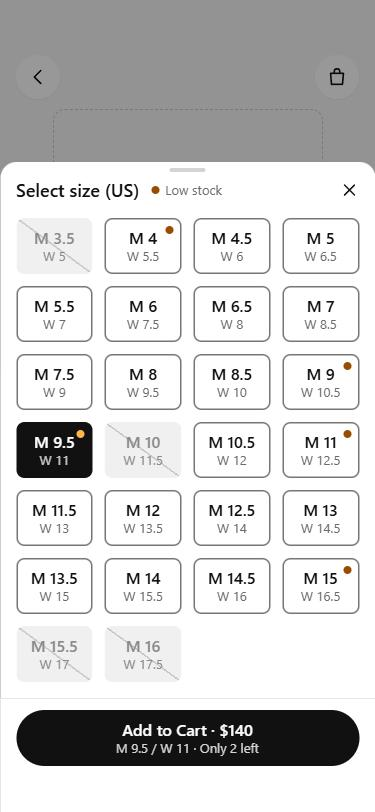
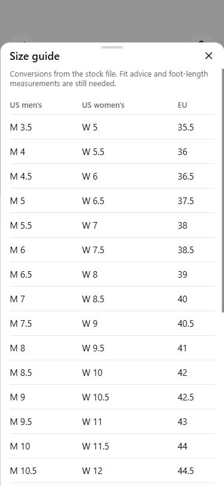
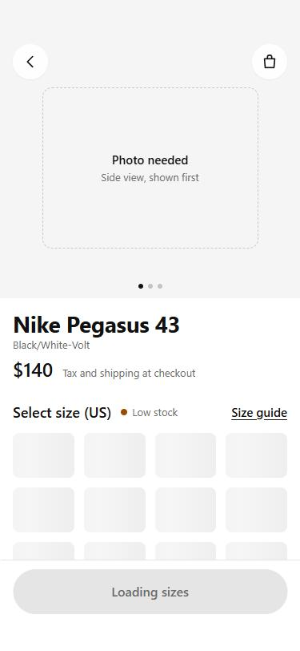

# Nike Pegasus 43 – mobile product page prototype (375px)

A single-file, no-build prototype of a mobile product page for the Nike Pegasus 43. It is designed for a 375px-wide screen. The two goals are **zero layout shift while loading** and **key information and actions within thumb reach**.

**Live prototype:** <https://noodiefroggo.github.io/pegasus-43-mobile-pdp/>. Open it on a phone, or in DevTools at 375px wide.

> This is a concept prototype, not affiliated with or endorsed by Nike. The photos, product copy and reviews are placeholders.

| First screen (before launch) | Size sheet (after launch) | Size guide | Loading |
|---|---|---|---|
|  |  |  |  |

## Run it

The page loads stock from `pegasus-43-stock.json`, so serve the folder rather than opening the file directly:

```bash
python -m http.server 5175
```

Then open <http://localhost:5175/> with a 375px-wide viewport (in DevTools, choose a device such as iPhone 12/13 mini or iPhone SE).

## Files

| File | What it is |
|---|---|
| `index.html` | The whole prototype: HTML, CSS and JS, with no dependencies |
| `pegasus-43-stock.json` | Stock data: 26 sizes with price, colorway, stock level and launch date |
| `speed-budget.json` | Speed budget for a slow phone: Lighthouse performance ≥ 90, size grid moves 0 px, size buttons ≥ 44 px |
| [`BUILD_PROMPT.md`](BUILD_PROMPT.md) | The prompt that describes how to build this prototype |
| `screenshots/` | Images used in this README |

## Page structure (375 × 812)

| # | Part | Height |
|---|---|---:|
| – | Status bar safe area | 47 |
| 0 | Back and cart buttons (laid over the image) | 0 |
| 1 | Hero image, `40svh` | 325 |
| 2 | Name, colorway, price | 108 |
| 3 | Size selector: 60 header + 464 grid | 524 |
| 4 | Details: description and 3 expandable rows | 324 |
| 5 | Reviews ("open at launch" state) | 116 |
| 6 | Sticky cart bar + bottom safe area | 114 |

On a 375 × 667 screen the hero is 267px and the cart bar is 80px.

## Design decisions

- **Layout is fixed before first paint.** Every loading skeleton uses the same box as the content that replaces it. Name, price and the cart bar are in the HTML, the page uses system fonts so no web font swaps in, and nothing is inserted above existing content. The built-in meter reports a CLS of **0**.
- **Checked on a slow phone.** On 28 Nov 2026 the page was tested at 375 × 812, 3x, Slow 4G and a 4x CPU slowdown, both locally and live. The size grid's top edge stayed at 492.8px from first paint to fully loaded, including slow and failed stock loads. CLS was 0 and Lighthouse performance was 100. `BUILD_PROMPT.md` describes how to repeat the check.
- **The hero uses `svh`, not `vh` or `dvh`**, so it doesn't resize when the mobile browser toolbar collapses. It is 40% of the screen height.
- **Price is shown once, under the name** (option B): a large `$140` with tax and shipping text beside it. The alternative, price to the right of the name (option A), is kept behind `?price=a` for comparison. Option B costs 36px, so on a 667-tall screen two full rows of sizes show above the cart bar, with the third peeking out.
- **The colorway is a label under the name.** Price and colorway are the same for every size, so the size buttons carry only the size and its stock status.
- **Size grid:** 4 columns × 7 rows of 76.75 × 56 buttons with 12px gaps, in `display_order` from the stock file. Each button reads "M 9.5" over "W 11", because both on one line won't fit at this width.
  - **Available:** white with a 1.5px stroke.
  - **Low stock (1–5 left):** an 8px amber dot, and the cart bar says "Only N left".
  - **Sold out:** grey with a diagonal line and disabled. Sold out is shown by shape as well as colour.
  - **Selected:** solid black.
- **Mis-tap protection:** the gaps between buttons are dead space, and a selection only happens when the finger is released, so scrolling never selects a size. Tapping a size never adds to the cart.
- **Accessibility:** the sizes are a native radio group, and each one reads in full, for example "Men's 9.5, women's 11, 2 left". Sheets are modal: the page behind them is inert, Escape closes them and focus returns to where it was. Shimmer and transitions turn off when reduced motion is on.
- **Sticky cart bar:** one 343 × 56 button whose label follows the state:

  | State | Button text |
  |---|---|
  | Loading | "Loading sizes" (disabled) |
  | Load failed | "Try again" (retries) |
  | No size chosen | "Select size · $140" (opens the size sheet) |
  | Size chosen | "Add to Cart · $140" with "M 9.5 / W 11 · Only 2 left" under it |
  | Adding | Spinner |
  | Added | "Added · View cart" |
  | Before launch | "Notify me · Launches 10 Dec" (asks for a size first) |
- **Size sheet:** the same grid, reachable with the thumb from anywhere on the page. It stays in sync with the page grid and closes with the X, by tapping the backdrop, with Escape or by swiping down.
- **Before the launch date** (`launch_date` in the stock file) the page assumes no early ordering, so the main action is a launch alert instead of add to cart.
- **No invented content.** Reviews show "Reviews open at launch", and the photo and copy slots are marked as placeholders.

## Prototype controls

A dashed panel at the bottom of the page switches states. Each setting is also a URL parameter:

| Param | Values |
|---|---|
| `launch` | `auto` (compares today with the launch date), `pre`, `live` |
| `price` | `b` (default, under the name), `a` (right of the name) |
| `stock` | `normal`, `slow` (2.5s skeleton), `fail` (first load fails, then retry) |
| `add` | `ok`, `fail` (first add or alert fails) |
| `reviews` | `launch`, `skeleton` |
| `frame` | `812` (47 / 34 safe areas), `667` (20 / 0), or the device's own |
| `controls` | `0` hides the panel |

## Still open

- Product photos, description, specs, fit notes and real reviews.
- Whether early ordering is allowed before launch.
- Currency: the stock file has no currency, and USD is assumed.
- `index.html` doesn't have the five `data-testid` attributes that the speed check reads yet (`size-grid`, `size-button`, `size-button-sold-out`, `main-photo`, `price`).
- The cart bar label moves 8px when "Sizes didn't load" appears under it. It's below the size grid, so the budget doesn't count it.
